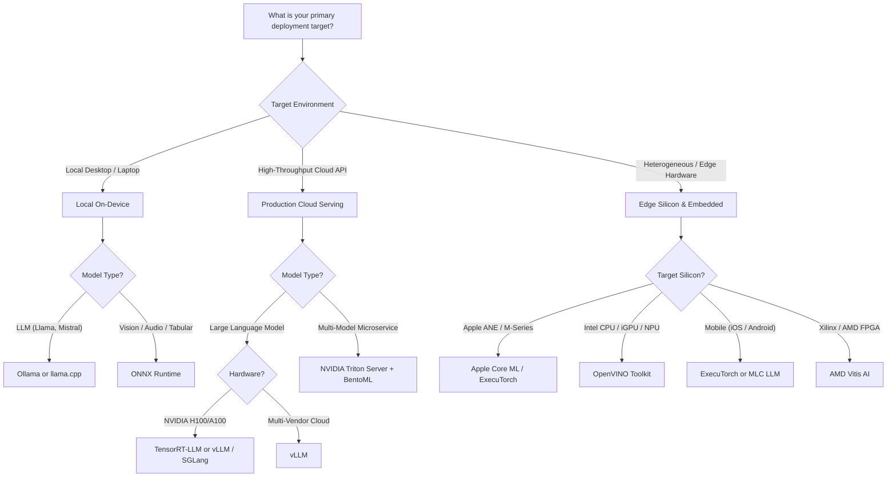

 

     

  <b>A curated list of high-performance Machine Learning inference engines, hardware compilers, cross-platform execution providers (EPs), and production model serving solutions.</b>
   
  <i>Focusing on low-latency kernel fusion, hardware-specific compilation, LLM serving, and edge deployment across GPUs, CPUs, NPUs, and FPGAs.</i>

---

## 📑 Table of Contents

- [📊 Sector Overview & Market Dynamics](#-sector-overview--market-dynamics)
- [☁️ SaaS & Hosted Inference Platforms](#️-saas--hosted-inference-platforms)
- [💻 Open-Source GitHub Projects](#-open-source-github-projects)
  - [1. Ollama](#1-ollama)
  - [2. llama.cpp](#2-llamacpp)
  - [3. vLLM](#3-vllm)
  - [4. SGLang](#4-sglang)
  - [5. MLC LLM](#5-mlc-llm)
  - [6. ONNX Runtime](#6-onnx-runtime)
  - [7. Candle](#7-candle)
  - [8. GGML](#8-ggml)
  - [9. TensorRT-LLM](#9-tensorrt-llm)
  - [10. Apache TVM](#10-apache-tvm)
  - [11. NVIDIA TensorRT](#11-nvidia-tensorrt)
  - [12. Triton Inference Server](#12-triton-inference-server)
  - [13. OpenVINO](#13-openvino)
  - [14. Text Generation Inference (TGI)](#14-text-generation-inference-tgi)
  - [15. BentoML](#15-bentoml)
  - [16. ExecuTorch](#16-executorch)
  - [17. DeepSpeed-MII](#17-deepspeed-mii)
  - [18. Vitis AI](#18-vitis-ai)
- [🧩 Architecture & Hardware Support Matrix](#-architecture--hardware-support-matrix)
- [💡 Decision Guide: Choosing the Right Engine](#-decision-guide-choosing-the-right-engine)
- [❓ Frequently Asked Questions (FAQ)](#-frequently-asked-questions-faq)
- [🤝 How to Contribute](#-how-to-contribute)
- [💖 Support & Community](#-support--community)
- [📈 Star History](#-star-history)
- [📜 Disclaimer](#-disclaimer)

---

## 📊 Sector Overview & Market Dynamics

The global AI inference market was valued at **$25.8 billion in 2024** and is projected to expand beyond **$150 billion by 2030 (CAGR ~28%)**, rapidly outpacing AI training expenditure as enterprises shift from model development to continuous, 24/7 inference workloads in production.

The sector demonstrates a **bifurcated market structure**:
- **Hardware & Cloud Tier (Concentrated)**: Upstream silicon and hyperscaler hosting are heavily concentrated among a handful of dominant market leaders (NVIDIA, Amazon Web Services, Microsoft Azure, Google Cloud).
- **Execution & Optimization Tier (Moderately Fragmented)**: The inference compiler and runtime orchestration layer is vigorously contested and fragmented. Open-source runtimes (vLLM, llama.cpp, SGLang, ONNX Runtime) and specialized silicon engines (Groq LPUs, Intel OpenVINO, Apple Neural Engine, AMD ROCm) compete actively to eliminate GPU memory bottlenecks, maximize PagedAttention throughput, and drive down inference costs per million tokens without single-vendor lock-in.

---

## ☁️ SaaS & Hosted Inference Platforms

The table below tracks premier managed and hosted inference platforms, ranked in **descending order by company size** (market capitalization or latest enterprise valuation).

| 🏢 Platform / Service | 💼 Company Size (Rev / Valuation) | 🎯 Core Capabilities & Architecture | 💳 Specific Starting Tier Pricing | 🎁 Free Tier Limits / Free Trial Plan |
| :--- | :--- | :--- | :--- | :--- |
| **[Apple Core ML & Tools](https://developer.apple.com/machine-learning/core-ml/)** | **~$3.5 Trillion** Market Cap (~$385B Annual Revenue) | Native on-device compilation for Apple Silicon (CPU, GPU, and Apple Neural Engine). Automatic weight quantization and Transformer KV caching. | **$99/year** for Apple Developer Program (Required for distribution; macOS Xcode compilation tools are **$0.00**) | **Free forever plan**: 100% free locally on macOS & iOS with unlimited on-device Neural Engine execution and $0 per-inference fees. |
| **[NVIDIA NIM & DGX Cloud](https://www.nvidia.com/en-us/ai-data-science/products/nim/)** | **~$3.2 Trillion** Market Cap (~$60B+ Annual Revenue) | Pre-packaged, microservice-based inference containers optimized with TensorRT and TensorRT-LLM for NVIDIA GPUs. | **$1.00/GPU-hour** pay-as-you-go or **$4,500/GPU/year** via NVIDIA AI Enterprise; API Catalog starts at **$0.10 / 1M tokens**. | **Free trial**: 1,000 free API inference credits upon registration for 90 days via NVIDIA Developer Program. |
| **[Microsoft Azure AI Inference](https://azure.microsoft.com/en-us/products/ai-services)** | **~$3.1 Trillion** Market Cap (~$245B Annual Revenue) | Managed model endpoints with ONNX Runtime, DeepSpeed, and Triton acceleration. Serverless foundation APIs and managed GPU VM fleets. | **$0.070/hour** for CPU instances (`Standard_B2s`); Serverless models starting at **$0.15 / 1M tokens** (`gpt-4o-mini`). | **Free trial**: **$200 Azure credit** for 30 days plus 12 months of popular free services, including 50,000 free monthly AI inference calls. |
| **[Google Cloud Vertex AI Prediction](https://cloud.google.com/vertex-ai)** | **~$2.1 Trillion** Market Cap (~$307B Annual Revenue) | Scalable serving for TensorFlow, PyTorch, and ONNX models on Google Cloud TPUs (v4/v5e) and NVIDIA GPUs (A100/H100). | **$0.054/hour** for CPU (`e2-standard-2`) and **$0.35/hour** for GPU (`NVIDIA T4`); Foundation models from **$0.075 / 1M tokens** (`Gemini 1.5 Flash`). | **Free trial**: **$300 free trial credits** valid for 90 days across all Google Cloud services; includes 6 free AutoML prediction node-hours. |
| **[Amazon SageMaker Inference](https://aws.amazon.com/sagemaker/deploy/)** | **~$1.9 Trillion** Market Cap (~$575B Annual Revenue) | Multi-model serving, autoscaling endpoints, and AWS Inferentia2 / Trainium silicon acceleration alongside NVIDIA GPU instances. | **$0.046/hour** for real-time CPU (`ml.t3.medium`) or **$0.736/hour** for GPU (`ml.g4dn.xlarge`); Serverless from **$0.000020/second**. | **Free tier**: **250 hours/month** of `ml.t2.medium` or `ml.t3.medium` for real-time inference during the first 2 consecutive months. |
| **[Cloudflare Workers AI](https://developers.cloudflare.com/workers-ai/)** | **~$35 Billion** Market Cap (~$1.3B Annual Revenue) | Edge-native serverless inference across 300+ global data centers with sub-50ms latency using NVIDIA GPUs at the edge. | **$5.00/month** (Workers Paid plan includes 10M requests) + **$0.011 / 1,000 Neurons** for inference computations. | **Free forever plan**: **10,000 Neurons per day** free forever across models like Llama 3.1 8B, Whisper, and BGE Embeddings. |
| **[Hugging Face Inference Endpoints](https://huggingface.co/inference-endpoints)** | **$4.5 Billion** Valuation | Production-ready dedicated endpoints deploying any Hugging Face Hub checkpoint with vLLM, TGI, and ONNX backends. | **$0.06/hour** for dedicated CPU (Intel Xeon 2 vCPU, 4GB RAM) or **$0.60/hour** for dedicated GPU (NVIDIA T4 16GB). | **Free forever plan**: Serverless Inference API is free forever up to **30,000 requests/month** for public models under 10GB. |
| **[GroqCloud](https://groq.com/)** | **$2.8 Billion** Valuation | Ultra-high-speed LLM inference powered by custom Language Processing Units (LPUs) achieving 500+ tokens/second. | **$0.05 / 1M input tokens** for `Llama-3.1-8B` and **$0.59 / 1M input tokens** for `Llama-3.1-70B`. | **Free forever plan**: **30 requests/minute**, up to **14,400 requests/day** and 7,000 tokens/minute for non-commercial exploration. |
| **[Together AI](https://www.together.ai/)** | **$1.25 Billion** Valuation | Cloud inference engine optimized with FlashAttention-3 and custom CUDA kernels for open-weight models. | **$0.10 / 1M tokens** for `Llama-3-8B` serverless; dedicated GPU clusters starting from **$1.00/GPU-hour** (RTX 4090). | **Free trial**: **$5.00 free credit** valid for 90 days upon account verification (~50 million tokens of Llama-3-8B). |
| **[Fireworks AI](https://fireworks.ai/)** | **$552 Million** Valuation | High-throughput compound AI inference platform powered by speculative decoding and LoRA dynamic adapter routing. | **$0.20 / 1M tokens** for models up to 16B parameters; dedicated on-demand endpoints starting at **$0.65/GPU-hour**. | **Free trial**: **$1.00 free credit** upon signup for 3 months, plus a persistent free tier of **1,000 requests/day** on starter models. |
| **[Replicate](https://replicate.com/)** | **$350 Million** Valuation | Cloud platform running open-source machine learning models with a public API and autoscale-to-zero serverless containers. | **$0.000100/second** ($0.36/hour) for 4x CPU; **$0.000225/second** ($0.81/hour) for NVIDIA T4 GPU; **$0.000725/second** for A40 GPU. | **Free trial**: **$5.00 free compute credits** granted upon GitHub authentication (~150 to 200 free model predictions). |
| **[Baseten](https://www.baseten.co/)** | **$250 Million** Valuation | High-performance model serving infrastructure with cold-start times under 5 seconds using Truss packaging and TensorRT-LLM. | **$0.40/hour** for dedicated NVIDIA A10G GPUs (prorated per millisecond) with zero minimum baseline charges. | **Free trial**: **$30.00 free compute credits** valid for 30 days upon email and phone verification. |
| **[Modal](https://modal.com/)** | **$200 Million** Valuation | Serverless cloud compute platform designed for running Python AI workloads, LLM inference engines, and custom container runtimes. | **$0.000019/core-second** ($0.068/core-hour) for CPU; **$0.000164/second** ($0.59/hour) for NVIDIA T4 GPU. | **Free forever plan**: **$30.00 free compute credits every single month** forever on the Community tier. |

---

## 💻 Open-Source GitHub Projects

The premier open-source machine learning inference engines and hardware compilers, **sorted in descending order by GitHub stargazers count**.

### 1. [Ollama](https://github.com/ollama/ollama) 
- **Primary Domain**: Local LLM Deployment & Desktop Serving  
- **License**: MIT  
- **Architecture**: Bundles llama.cpp with a clean CLI, REST API, Modelfile configuration, and automatic GPU acceleration (Apple Silicon Metal, NVIDIA CUDA, AMD ROCm).  
- **Best For**: Developers wanting local Large Language Models up and running on macOS, Linux, or Windows with a single command (`ollama run llama3`).

### 2. [llama.cpp](https://github.com/ggerganov/llama.cpp) 
- **Primary Domain**: Lightweight C/C++ Inference for LLMs  
- **License**: MIT  
- **Architecture**: Pure C/C++ implementation without external dependencies. Features state-of-the-art integer quantization (k-quants 2-bit through 8-bit, IQ1/IQ2/IQ3/IQ4) for consumer CPUs, Apple Silicon Metal, CUDA, OpenCL, SYCL, and Vulkan.  
- **Best For**: Maximum portability across commodity hardware, edge devices, MacBooks, and resource-constrained environments.

### 3. [vLLM](https://github.com/vllm-project/vllm) 
- **Primary Domain**: High-Throughput Production LLM Serving  
- **License**: Apache-2.0  
- **Architecture**: Invented **PagedAttention** to eliminate KV-cache fragmentation. Features continuous batching, chunked prefill, speculative decoding, and native FP8/AWQ/GPTQ quantization support across NVIDIA GPUs, AMD ROCm, and AWS Neuron.  
- **Best For**: High-concurrency enterprise LLM serving requiring maximal token throughput and low per-request serving costs.

### 4. [SGLang](https://github.com/sgl-project/sglang) 
- **Primary Domain**: Structured LLM Decoding & Fast Multi-Turn Serving  
- **License**: Apache-2.0  
- **Architecture**: Introduces **RadixAttention** for automatic KV cache reuse across multi-turn chats, shared system prompts, and tree-search algorithms. Integrates a Python front-end language with an ultra-fast C++/CUDA runtime engine.  
- **Best For**: Complex multi-turn agent workflows, structured JSON generation, and retrieval-augmented generation (RAG) pipelines.

### 5. [MLC LLM](https://github.com/mlc-ai/mlc-llm) 
- **Primary Domain**: Universal On-Device LLM Compilation  
- **License**: Apache-2.0  
- **Architecture**: Powered by Apache TVM Unity. Compiles language models into native code and lightweight runtimes executable on iOS, Android, WebGPU/WASM, macOS, Linux, and Windows.  
- **Best For**: Cross-platform client applications that require running generative models directly inside mobile apps or web browsers.

### 6. [ONNX Runtime](https://github.com/microsoft/onnxruntime) 
- **Primary Domain**: Cross-Platform Universal Model Accelerator  
- **License**: MIT  
- **Architecture**: Connects abstract ONNX computation graphs to heterogeneous hardware through **Execution Providers (EPs)**: NVIDIA TensorRT/CUDA, Intel OpenVINO, Qualcomm QNN, Apple CoreML, and WebGPU. Features automated graph optimizations, kernel fusion, and FP16/INT8 quantization.  
- **Best For**: Teams needing a unified runtime to deploy Computer Vision, NLP, and tabular models across diverse vendor hardware.

### 7. [Candle](https://github.com/huggingface/candle) 
- **Primary Domain**: Minimalist Rust ML Framework  
- **License**: Apache-2.0 / MIT  
- **Architecture**: Lightweight, zero-Python Rust ML framework created by Hugging Face. Supports CUDA, Metal, and CPU backends with minimal binary size and zero heavy runtime dependencies.  
- **Best For**: Serverless functions, WebAssembly, and systems programming where Python runtime overhead and binary bloat are unacceptable.

### 8. [GGML](https://github.com/ggerganov/ggml) 
- **Primary Domain**: Low-Level Tensor Library for Machine Learning  
- **License**: MIT  
- **Architecture**: The underlying C tensor library that powers llama.cpp and whisper.cpp. Features compact memory layouts, SIMD intrinsics (AVX2, AVX-512, NEON), and direct hardware acceleration.  
- **Best For**: Engineers building custom, low-level on-device inference engines and embedded AI runtimes.

### 9. [TensorRT-LLM](https://github.com/NVIDIA/TensorRT-LLM) 
- **Primary Domain**: High-Performance NVIDIA GPU LLM Optimization  
- **License**: Apache-2.0  
- **Architecture**: NVIDIA's purpose-built library for LLM inference. Combines TensorRT kernel compilers, FlashAttention-3, in-flight batching, FP8 precision, and multi-GPU tensor parallelism.  
- **Best For**: Production data centers utilizing NVIDIA Ampere, Ada Lovelace, Hopper, and Blackwell GPUs for peak token throughput.

### 10. [Apache TVM](https://github.com/apache/tvm) 
- **Primary Domain**: End-to-End Deep Learning Compiler Stack  
- **License**: Apache-2.0  
- **Architecture**: Automatically optimizes and compiles high-level models into bare-metal machine code for CPUs, GPUs, DSPs, and custom ASICs using auto-tuning (AutoTVM/MetaSchedule) and the Relax graph intermediate representation.  
- **Best For**: Hardware vendors, embedded systems engineers, and teams targeting non-standard architectures.

### 11. [NVIDIA TensorRT](https://github.com/NVIDIA/TensorRT) 
- **Primary Domain**: Peak GPU Optimization & Graph Compilation  
- **License**: Apache-2.0  
- **Architecture**: Device-specific compiler providing layer fusion, dynamic tensor memory management, kernel auto-tuning, and INT8/FP16 calibration to achieve 2x to 5x latency reductions on NVIDIA hardware.  
- **Best For**: Performance-critical Computer Vision, Speech, and NLP models running on NVIDIA Jetson edge modules or data center GPUs.

### 12. [Triton Inference Server](https://github.com/triton-inference-server/server) 
- **Primary Domain**: Enterprise Multi-Framework Model Serving  
- **License**: BSD-3-Clause  
- **Architecture**: Industrial serving server supporting concurrent execution across TensorRT, ONNX Runtime, PyTorch, OpenVINO, and vLLM backends. Provides gRPC/HTTP endpoints, dynamic batching, and GPU model pipelining.  
- **Best For**: Enterprise microservice architectures serving heterogeneous model families from a shared GPU pool.

### 13. [OpenVINO](https://github.com/openvinotoolkit/openvino) 
- **Primary Domain**: Intel Hardware Inference Optimization  
- **License**: Apache-2.0  
- **Architecture**: Intel's dedicated inference toolkit for Intel CPUs (AVX2 / AVX-512 / AMX), integrated GPUs, discrete Intel Arc GPUs, and Intel NPUs. Includes NNCF for model compression, pruning, and INT8 quantization.  
- **Best For**: Deployments hosted on Intel hardware seeking 1.5x–3x speedups without specialized accelerator cards.

### 14. [Text Generation Inference (TGI)](https://github.com/huggingface/text-generation-inference) 
- **Primary Domain**: Hugging Face LLM Serving Toolkit  
- **License**: Apache-2.0  
- **Architecture**: Production-grade serving server developed by Hugging Face with Tensor Parallelism, streaming token responses, speculative decoding, and watermarking. Powers Hugging Face Hub inference.  
- **Best For**: Rapid deployment of Hugging Face transformer models into production with enterprise-ready monitoring and security.

### 15. [BentoML](https://github.com/bentoml/BentoML) 
- **Primary Domain**: Unified AI Application & Service Architecture  
- **License**: Apache-2.0  
- **Architecture**: Orchestrates model serving pipelines into containerized microservices. Combines custom Python logic with high-performance backends (vLLM, ONNX, PyTorch) and provides built-in adaptive batching.  
- **Best For**: Production AI engineering teams shipping full-stack machine learning applications and composite multi-model pipelines.

### 16. [ExecuTorch](https://github.com/pytorch/executorch) 
- **Primary Domain**: Native PyTorch On-Device & Edge Runtime  
- **License**: BSD-3-Clause  
- **Architecture**: Meta's next-generation on-device runtime for PyTorch 2.x. Features a lightweight footprint (<50 KB), zero Python dependency, and hardware delegates for Apple Metal, ARM Ethos NPU, and Qualcomm Hexagon.  
- **Best For**: Mobile and embedded software developers deploying PyTorch models natively to iOS, Android, and wearable devices.

### 17. [DeepSpeed-MII](https://github.com/microsoft/DeepSpeed-MII) 
- **Primary Domain**: Low-Latency Multi-GPU Model Serving  
- **License**: Apache-2.0  
- **Architecture**: Microsoft's DeepSpeed Model Inference & Interface. Leverages DeepSpeed-FastGen for dynamic split-fuse scheduling, ZeRO inference memory partitioning, and multi-GPU tensor parallelism.  
- **Best For**: Serving large-scale deep learning models across clusters of multi-GPU servers with high throughput.

### 18. [Vitis AI](https://github.com/Xilinx/Vitis-AI) 
- **Primary Domain**: FPGA & Adaptive SoC Acceleration  
- **License**: Apache-2.0  
- **Architecture**: AMD/Xilinx's dedicated development stack for FPGA inference. Compiles trained neural networks down to Deep Learning Processor Unit (DPU) bitstreams for Zynq UltraScale+, Versal AI Core, and Kria SoMs.  
- **Best For**: Aerospace, defense, robotics, and industrial automation where deterministic latency and extreme power efficiency are paramount.

---

## 🧩 Architecture & Hardware Support Matrix

| Inference Engine | Primary Focus | NVIDIA GPU | AMD ROCm | Apple Silicon / ANE | Intel CPU / NPU | ARM / Mobile | WebGPU / WASM |
| :--- | :--- | :---: | :---: | :---: | :---: | :---: | :---: |
| **Ollama** | Local LLM Serving | ✅ | ✅ | ✅ | ✅ | ✅ | ❌ |
| **llama.cpp** | Quantized LLMs | ✅ | ✅ | ✅ | ✅ | ✅ | ✅ |
| **vLLM** | High-Throughput Serving | ✅ | ✅ | ❌ | ✅ | ❌ | ❌ |
| **SGLang** | Structured LLM Serving | ✅ | ✅ | ❌ | ❌ | ❌ | ❌ |
| **MLC LLM** | Universal Edge Compilation | ✅ | ✅ | ✅ | ✅ | ✅ | ✅ |
| **ONNX Runtime** | Cross-Platform Universal | ✅ | ✅ | ✅ | ✅ | ✅ | ✅ |
| **Candle** | Minimalist Rust ML | ✅ | ❌ | ✅ | ✅ | ❌ | ✅ |
| **TensorRT-LLM** | Extreme NVIDIA LLM Speed | ✅ | ❌ | ❌ | ❌ | ❌ | ❌ |
| **Apache TVM** | Compiler Stack | ✅ | ✅ | ✅ | ✅ | ✅ | ✅ |
| **NVIDIA TensorRT** | GPU Graph Optimization | ✅ | ❌ | ❌ | ❌ | ❌ | ❌ |
| **Triton Server** | Multi-Model Serving | ✅ | ✅ | ❌ | ✅ | ✅ | ❌ |
| **OpenVINO** | Intel Hardware | ❌ | ❌ | ❌ | ✅ | ✅ | ❌ |
| **TGI** | Hugging Face LLM Serving | ✅ | ✅ | ❌ | ✅ | ❌ | ❌ |
| **ExecuTorch** | On-Device PyTorch | ❌ | ❌ | ✅ | ✅ | ✅ | ❌ |
| **Vitis AI** | FPGA / Adaptive SoCs | ❌ | ❌ | ❌ | ❌ | ✅ | ❌ |

---

## 💡 Decision Guide: Choosing the Right Engine

- **For local developer prototyping**: Choose **[Ollama](https://github.com/ollama/ollama)** or **[llama.cpp](https://github.com/ggerganov/llama.cpp)**.
- **For production LLM serving with highest concurrent throughput**: Choose **[vLLM](https://github.com/vllm-project/vllm)** or **[SGLang](https://github.com/sgl-project/sglang)**.
- **For maximum raw speed on NVIDIA data center GPUs**: Compile engines with **[TensorRT-LLM](https://github.com/NVIDIA/TensorRT-LLM)** and **[TensorRT](https://github.com/NVIDIA/TensorRT)**.
- **For cross-hardware model portability across diverse servers**: Choose **[ONNX Runtime](https://github.com/microsoft/onnxruntime)** with selectable Execution Providers.
- **For dedicated Intel hardware deployments**: Deploy with **[OpenVINO](https://github.com/openvinotoolkit/openvino)** (requires AVX2+).
- **For on-device mobile applications (iOS/Android)**: Choose **[ExecuTorch](https://github.com/pytorch/executorch)** or **[MLC LLM](https://github.com/mlc-ai/mlc-llm)**.

---

## ❓ Frequently Asked Questions (FAQ)

### What is an ML inference engine and how does it differ from a model training framework?
A machine learning inference engine is a specialized runtime and compiler optimized specifically for *forward-pass execution* of pre-trained models. While training frameworks (like PyTorch or JAX) prioritize backpropagation, automatic differentiation, gradient tracking, and optimizer state storage, inference engines discard training graphs to focus strictly on latency minimization, layer/kernel fusion, memory footprint reduction, KV-cache management, and hardware-specific compilation.

### When should I choose ONNX Runtime instead of native vendor compilers like TensorRT or OpenVINO?
Use **ONNX Runtime** when your system must deploy models across heterogeneous hardware (such as running the exact same model artifact on an NVIDIA GPU, an Intel CPU, and an Apple silicon laptop) without rewriting your inference pipelines. If you are exclusively running on a single vendor's silicon and demand peak throughput, vendor-native engines (**TensorRT** on NVIDIA, **OpenVINO** on Intel) typically yield 1.5x to 3x higher performance due to lower-level kernel auto-tuning.

### What is PagedAttention and why has it revolutionized LLM inference?
Introduced by the **vLLM** project, PagedAttention manages the Key-Value (KV) cache memory using virtual memory paging concepts similar to an operating system. Traditional LLM serving allocates contiguous memory blocks for the maximum possible sequence length, wasting up to 60–80% of GPU VRAM through memory fragmentation. PagedAttention partitions the KV cache into fixed-size virtual memory pages, allowing near-zero memory waste and enabling massive increases in concurrent serving batch sizes.

---

## 🤝 How to Contribute

Contributions are warmly welcomed! To contribute an inference engine or platform:

1. **Fork** this repository.
2. Create a descriptive feature branch (`git checkout -b add-new-engine`).
3. Add the open-source repo or SaaS product maintaining the table format and star sorting order.
4. Verify all links and citations.
5. Submit a **Pull Request** explaining the tool's performance profile and hardware tier.

Please review our [Contribution Guidelines](https://github.com/ishandutta2007/Awesome-Awesome-Awesome) for detailed criteria.

---

## 💖 Support & Community

If this curated compilation helps accelerate your machine learning deployment, please consider:
- ⭐ **Starring** the repository to support visibility.
- 🍴 **Forking** the project and contributing your hardware benchmarks.
- 📣 **Sharing** this guide with colleagues and ML engineering communities.
- ☕ **Sponsoring** maintenance and open-source research via the [GitHub Sponsor Dashboard](https://github.com/sponsors/ishandutta2007).

---

## 📈 Star History

---

## 📜 Disclaimer

- This is a community-curated list maintained for educational and architectural reference purposes.
- Inference engines differ significantly in hardware target, compilation complexity, and precision profiles. Always benchmark models on your exact production target silicon and run validation datasets to confirm numerical accuracy following quantization (INT8/FP8/AWQ).
- All brand names, logos, and registered trademarks belong to their respective corporate owners.

  Maintained with ❤️ by <a href="https://github.com/ishandutta2007">Ishan Dutta</a> and the open-source AI community.

